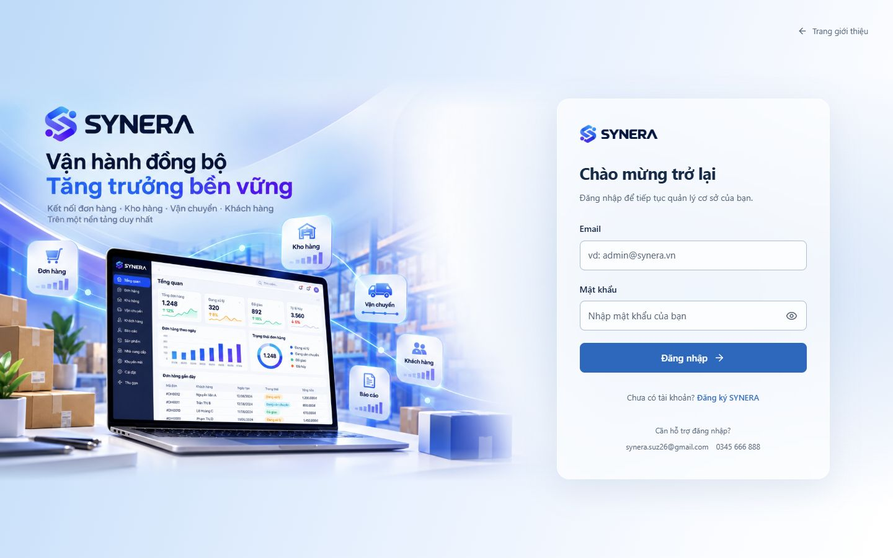
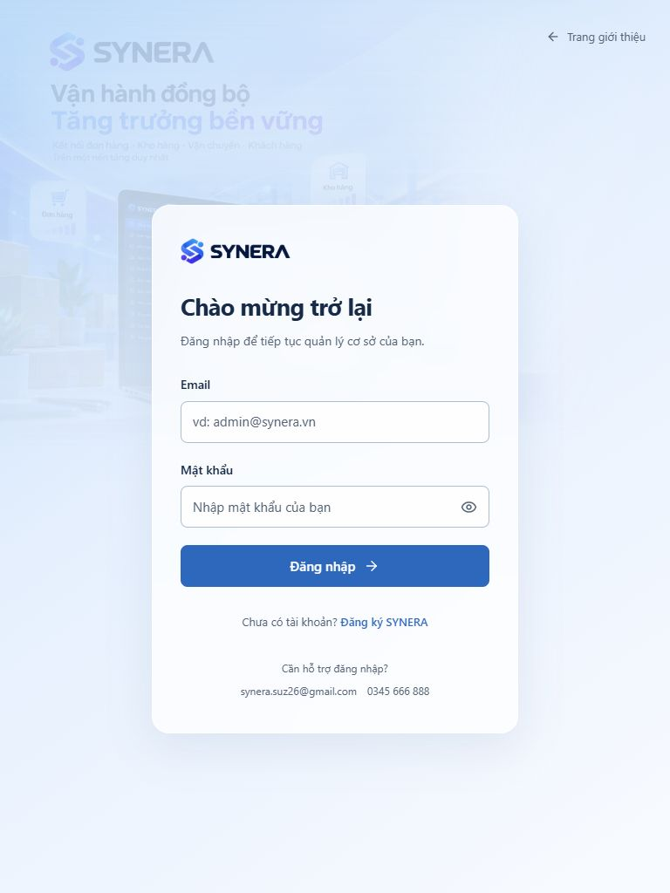
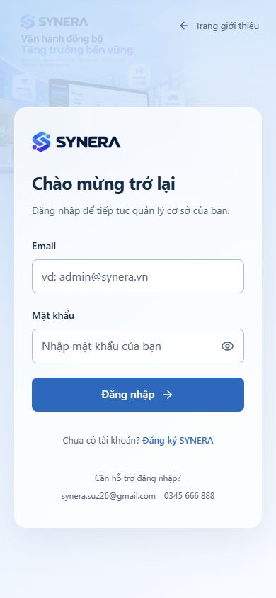

# Trang đăng nhập riêng của SYNERA

Nút Đăng nhập mở `/login` thay modal. Node hỗ trợ trực tiếp `/login`, `/login/`, HEAD và refresh; Cloudflare có adapter tại `app/login/page.tsx`. Đăng ký vẫn dùng form sẵn có trên landing.

## Thiết kế hiện tại

Theo bản mô tả và ba ảnh chủ dự án gửi ngày 28/10/2026: toàn viewport, hình quảng bá SYNERA bên trái, form kính sáng bên phải, nền xanh → xanh nhạt → gần trắng không có đường chia cứng. Desktop chia 58%/42%; form rộng tối đa 440px. Laptop, dashboard và module trong artwork được giữ đầy đủ bằng `object-fit: contain`, không crop laptop. Mask cả mép phải và mép trên/dưới giúp ảnh hòa vào nền. Mobile/tablet dùng hình mờ nhẹ phía sau form; không ép hai cột.

Giữ Segoe UI hỗ trợ tiếng Việt và màu SYNERA. Input 48px, hiện mật khẩu 44px, tiêu đề 25–27px; helper có tương phản với nền. Một nút chính xanh. Không thêm thông tin demo, ghi nhớ đăng nhập, quên mật khẩu hay Google vì chưa có tính năng tương ứng.

Gradient, glass, shadow và entrance 320–340ms là ngoại lệ theo yêu cầu trực tiếp của chủ dự án, thay quy tắc mặc định trong design-taste-frontend. Không dùng hình dark-glass theo nghĩa đen, glow, bounce, particle hoặc animation liên tục. CSS có fallback khi không hỗ trợ backdrop-filter, và tắt animation/transition khi `prefers-reduced-motion: reduce`.

## Asset và nguồn

- `frontend/public/assets/login/synera-product-environment.png`: bản nâng độ nét 1536×1024 do imagegen tạo từ ảnh quảng bá 540×360 chủ dự án cung cấp, giữ logo, tagline, laptop/dashboard và các module. Đây là biến thể từ ảnh tham chiếu, không phải file gốc nguyên byte. Không thêm ảnh kho Pexels vào thiết kế mới.
- Logo trên form dùng lại component/asset thương hiệu hiện có; bản logo trong artwork là một phần ảnh tham chiếu.
- Artwork là hình quảng bá; dữ liệu/chart in trong hình không phải dữ liệu live hoặc thay đổi màn hình quản trị.
- Ảnh kho Pexels của vòng đầu đã loại khỏi source branch vì không còn được dùng.
- Tham khảo luồng trang riêng: [Sapo](https://www.sapo.vn/dang-nhap-kenh-ban-hang.html). Không sao chép thông tin tài khoản hoặc asset Sapo.

## Xác thực và phạm vi

`LoginForm`, `sendAuth` và API giữ nguyên logic. Chỉ thêm placeholder cho form login mới. Email là phương thức thực sự hỗ trợ; không quảng cáo số điện thoại đăng nhập. Bước xác nhận HttpOnly session, ID người dùng và home route `/#/` được giữ nguyên trước chuyển trang. Validation, lỗi mạng, thông tin sai, focus đến alert, hiện mật khẩu và loading vẫn như trước. Profile ChatGPT giữ đường đăng nhập riêng có sẵn.

Link `/?auth=login` và đăng xuất cũ chuyển tiếp đến `/login`. `/login` với phiên hợp lệ về home; tracking người nhận giữ nguyên kiểm tra. Không đổi domain, account-auth, quyền, lưu dữ liệu, API payload hoặc trang quản trị. Không sửa landing video của cộng tác viên. Chỉ cập nhật branch `feat/dedicated-login-page`, PR #2; chưa merge main.

## Kiểm tra

- 51/51 Node tests đạt, gồm auth, domain, route mới và chặn source.
- TypeScript đạt; Node và Cloudflare production build đạt.
- Client bundle privacy check đạt cả hai profile.
- CUA kiểm tra hình ảnh tại 1920×1080, 1440×900, 768×1024, 390×844: không tràn ngang, form đọc được, laptop không crop; computed backdrop-filter thực tế `blur(24px)` sau build.
- Browser: đăng nhập sai giữ `/login`, focus alert; đăng nhập đúng bằng Enter về `/#/`; Tab/Space và hiện/ẩn mật khẩu hoạt động; mở menu mobile và đăng xuất quay lại login.
- Reduced motion: kiểm tra media rule trong source; không tuyên bố đã giả lập preference hệ điều hành. Form và nội dung hiển thị tĩnh khi animation bị tắt.
- Không chạy inspector ngoài CUA. Lint mặc định từ vòng đầu không dùng làm kết quả cho vòng này vì gradient/glass được người dùng yêu cầu.

Đánh giá hình ảnh: một nền liền, form nhỏ gọn có tương phản rõ, không còn khung trắng bọc toàn trang hoặc divider cứng. Ở mobile ảnh nhận diện giảm opacity 0.14 để ưu tiên thao tác. Chỉ có nội dung thật cần cho đăng nhập và liên hệ đã được chủ dự án cung cấp.








## Chạy

```powershell
git fetch origin
git switch --track origin/feat/dedicated-login-page
npm.cmd ci
npm.cmd run build:render
npm.cmd run dev:local
```

Mở `http://localhost:4182/login`. Preview riêng của phiên này: `http://127.0.0.1:4186/login`, dùng database QA riêng, không chia sẻ cookie với `localhost`.
